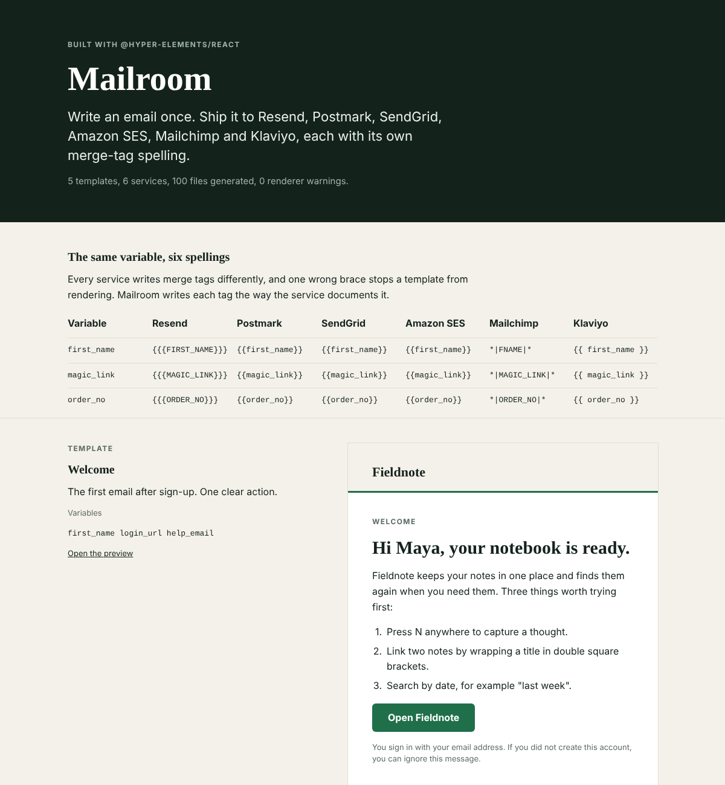
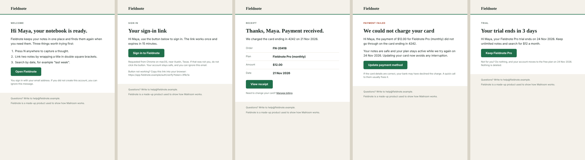
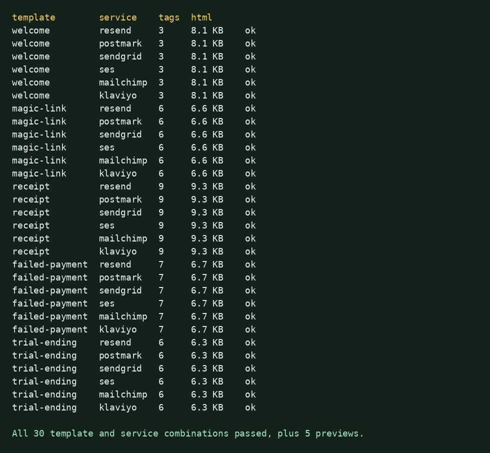

# Mailroom

**One email design, written once and compiled for every sending service.**

Built with [`@hyper-elements/react`](https://github.com/hyper-elements/hyper-elements) for the Hyper Elements Template Challenge.

Five lifecycle emails (welcome, sign-in link, receipt, failed payment, trial ending) are designed once with one theme. The build compiles each of them for **Resend, Postmark, SendGrid, Amazon SES, Mailchimp and Klaviyo**, writing every merge tag the way that service documents it, with a plain-text version and the JSON payload the service's "create template" call takes. A verifier then checks all 30 combinations.





## The problem

Every sending service spells a merge tag differently, and one wrong brace stops a template from rendering. Teams end up rewriting the same email once per service, or stay on one service because moving is a rewrite.

| Service | Merge tag | Notes |
|---|---|---|
| Resend | `{{{FIRST_NAME}}}` | Triple braces are required, double braces do not render |
| Postmark | `{{first_name}}` | Mustachio syntax |
| SendGrid | `{{first_name}}` | Handlebars, in a dynamic template version |
| Amazon SES | `{{first_name}}` | `TemplateData` is an escaped JSON string |
| Mailchimp | `*|FNAME|*` | Audience merge fields. FNAME, LNAME and EMAIL are built in |
| Klaviyo | `{{ first_name }}` | The subject line belongs to the message, not the template |

## How Hyper Elements is used

- **One theme.** `defineTheme()` in `src/theme.ts` holds the palette, the heading scale, the button and named styles. Every email takes the same `theme`.
- **The `mergeTag` option of `render()`.** Each template is rendered once per service with that service's tag function. Every `<MergeTag name="first_name" />` in the design is written in the right spelling in both the HTML and the plain text.
- **A thing worth knowing.** `mergeTag` rewrites `<MergeTag>` elements only. A tag inside a link, a subject line or the preview text stays exactly as you wrote it. So those use the same tag function as a plain string (`href={tag("magic_link")}`), and the renderer accepts every service's spelling there without warnings. The verifier checks that no stray tag from another service is left anywhere.
- **A page for the showroom.** `src/gallery.tsx` is a `Page` with live previews, a table of the same variable in six spellings, and a download table.
- **Also used:** `Email`, `Section`, `Heading`, `Text`, `Button`, `List`, `Table`, `Link`, `Html`, `MergeTag`. Diagnostics from `render()` are collected for all 30 outputs, and there are none.

## Verified, not assumed

`npm run verify` renders every template for every service and checks that:

- every declared variable appears, in that service's spelling, and nothing undeclared does
- no tag from another service is left in the HTML, links included
- the subject uses only declared variables, and the plain text carries the tags
- the output stays under the documented size limits (SES 500 KB, SendGrid 1 MB)
- the renderer reports no warnings, and every upload payload carries the HTML
- each preview has no tag left over



I broke it on purpose to check it: leaving a variable undeclared, and writing Resend tags with double braces. Both are caught.

## Run it

```bash
npm install
npm run all      # build, then verify
```

Open `out/index.html`. The output is in `out/<service>/<template>.html`, `.txt` and `.json`, plus `out/preview/`.

## Honest limits

- The upload payloads follow each service's documented request shape and are tested, but **I have not sent them to live accounts.** Check the docs for any service you use: [Resend](https://resend.com/docs/api-reference/templates/create-template), [Postmark](https://postmarkapp.com/support/article/1077-template-syntax), [SendGrid](https://www.twilio.com/docs/sendgrid/api-reference/transactional-templates/create-a-transactional-template), [Amazon SES](https://docs.aws.amazon.com/ses/latest/DeveloperGuide/send-personalized-email-api.html), [Mailchimp](https://mailchimp.com/help/all-the-merge-tags-cheat-sheet/), [Klaviyo](https://developers.klaviyo.com/en/reference/templates_api_overview).
- Templates use plain variables only. Loops and conditionals are written differently by each service, so they are not portable. A receipt with many line items would need service-specific code.
- Mailchimp is HTML only. Create an audience merge field for every tag that is not built in.
- These are transactional emails, so there is no unsubscribe link. Marketing sends need each service's own unsubscribe tag.
- Email clients cannot load web fonts, so every font is a system stack.
- Fieldnote is a made-up product. All sample data is fictional.

MIT licensed.
